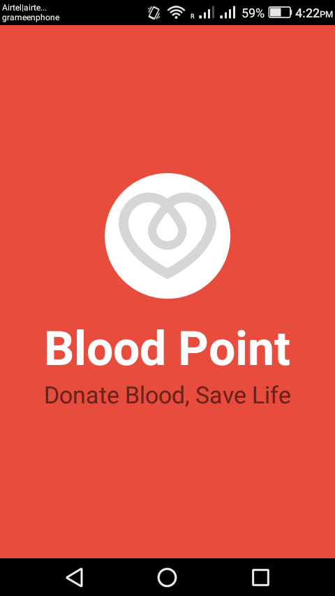
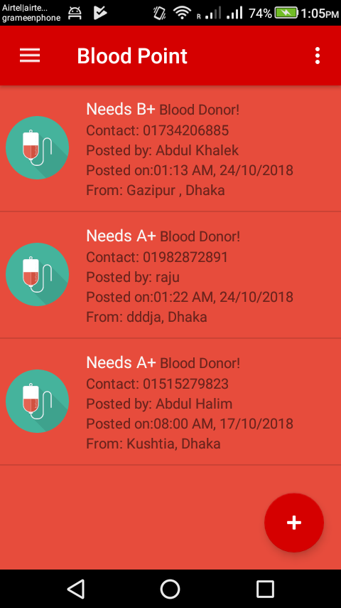
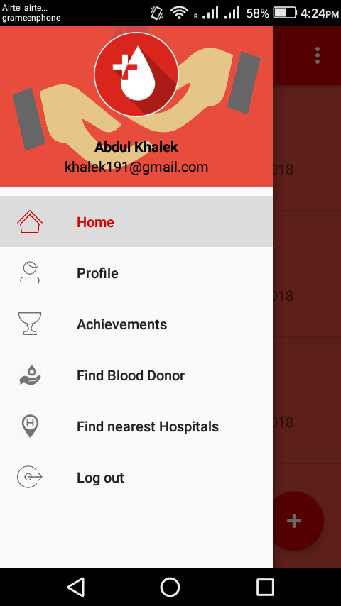
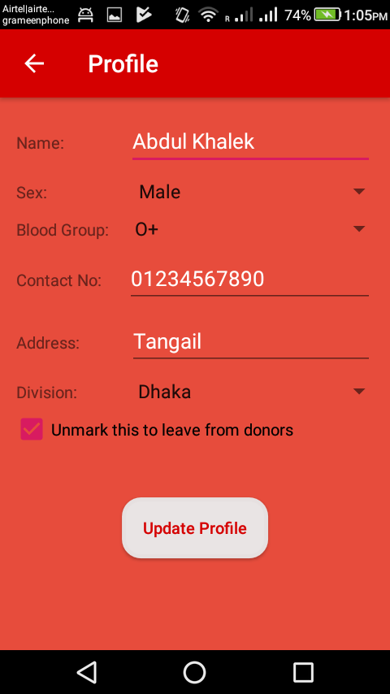
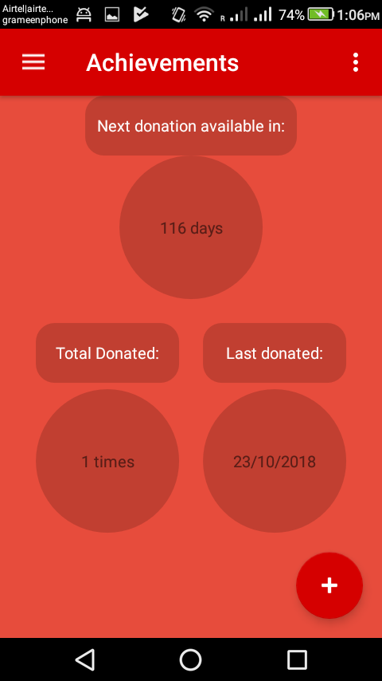
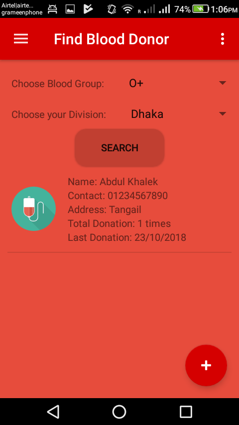
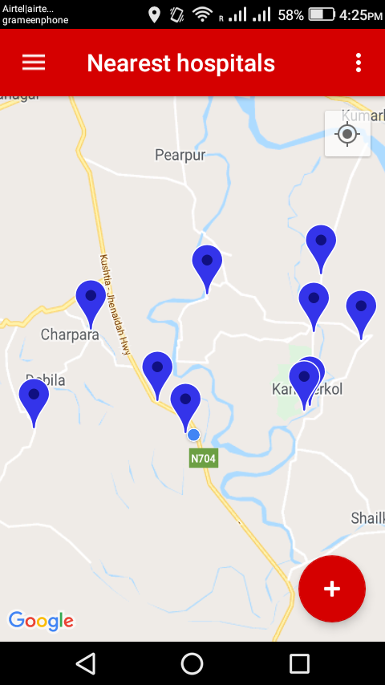

# About
“Blood Point” is an android application to collect or donate blood easily. Users who have an android phone & active internet connection can contact and start searching for a donor easily through this application. The purpose of this application is to help people belonging to rural areas.

# Features
Easy contact between blood donor and blood recipient through this android application.<br>
Included:
- User Databases
- User Login & Sign up
- Donor Details
- Finding blood group easily
- Finding Near By Hospitals
- Achievements & Rewards
       
# Tools used
- Firebase Database
- Firebase Authentication
- Google Maps Api
- Android Studio IDE
- Android version 4.0 or later
- Android SDK 17-28
  
# How to install?

You can install this application to test on your android smartphone. To download the signed application go to your chrome browser and copy-paste the download link:

```
https://github.com/imShakil/BloodBank/releases/latest/download/blood-point.apk
```

Download will be started automatically. After then install it on your android device.
Open the application, create an account. That's it.

N.B: It supports only in android version 4.0 or later.

# Preview:
       


[](http://hits.dwyl.com/imshakil/BloodBank)
 
 


# Database Snapshot
Follow this link: https://github.com/imShakil/BloodBank/wiki/Database-Snapshots
(This project can be used for any educational purpose and can be changed or modified in need.<br><b> A star will be appriciated if you think it might be helpful.</b>)<br>

# Changing Database and Package Name
I got so many mails on about 'How to change Database link and Package Name'. So, Who has queries can watch this video: https://www.youtube.com/watch?v=nAzAo7shGKQ&ab_channel=AnubhavAnand


# Contribution

If you would like to contribute in this project, you are always welcome. There is no `code` avilable in the `master` branch. Please `switch` specific version and make changes there. For example, the latest dev version is: https://github.com/imShakil/BloodBank/tree/2.1
You must need to create pull request to that specific branch to get it merged.

# Support

If you would like to support this project for better version, you can give some support [here](https://buymeacoffee.com/imshakil).


Thanks

Regards ~ Shakil


---

# Cloud Functions — contact request retention

The Firebase Cloud Functions in [`functions/`](functions/) include
`cleanupOldContactRequests`, a scheduled job that runs daily at 03:30 UTC and
deletes old entries under the `contactRequests` node.

## Retention period

| | |
|---|---|
| Variable | `CONTACT_REQUEST_RETENTION_DAYS` |
| Default | **90 days** — declared once in [`functions/lib/retention.js`](functions/lib/retention.js) |
| Accepted range | `1`–`3650` (integers only) |
| Invalid values | Rejected at runtime with a logged warning; the 90-day default is used instead |

A value of `0`, a negative number, a fraction or a non-numeric value is never
honoured: a retention of `0` would place the cutoff at "now" and delete every
contact request.

### Setting it locally

Create `functions/.env` (gitignored; see
[`functions/.env.example`](functions/.env.example)):

```
CONTACT_REQUEST_RETENTION_DAYS=1
```

Then run the emulator:

```bash
cd functions
npm ci
firebase emulators:start --only functions,database
```

### Setting it for a deployed project

Values live in `functions/.env.<projectId>`, which the deploy scripts write from
the environment preset (dev 30, staging 60, production 90):

```bash
./functions/scripts/deploy.sh production --dry-run   # preview
./functions/scripts/deploy.sh production             # deploy
```

Params are resolved at **deploy time** and baked into the deployed function, so
changing retention always requires a redeploy. See
[`functions/scripts/README.md`](functions/scripts/README.md).

## Cutoff behaviour

With `cutoff = now - retentionDays × 86400000`:

| `createdAt` | Result |
|---|---|
| `< cutoff` | **Deleted** |
| `== cutoff` | **Kept** — the boundary record is preserved |
| `> cutoff` | Kept |
| missing, `null`, or non-numeric | **Deleted** — treated as `0`, i.e. infinitely old |

Every run logs the effective `retentionDays`, whether it came from
configuration or the default (`retentionSource`), the cutoff, and the
inspected/deleted/preserved counts:

```bash
firebase functions:log --only cleanupOldContactRequests
```

## Running the tests

```bash
cd functions
npm ci
npm test
```

## Further reading

- [`functions/docs/RETENTION_DESIGN.md`](functions/docs/RETENTION_DESIGN.md) — design, decisions and logging contract
- [`functions/OPERATIONS_RUNBOOK.md`](functions/OPERATIONS_RUNBOOK.md) — operational procedures
- [`functions/test/features/contactRequestRetention.feature`](functions/test/features/contactRequestRetention.feature) — behaviour specification
